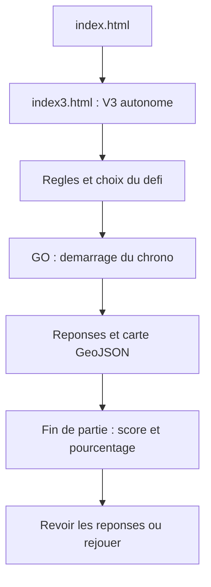

# PaysduMonde
Trouver le plus de pays par continent ou sur tous les 196 existant en 15min

Un jeu de géographie en français : retrouver des pays avant la fin du chrono et les voir apparaître en vert sur la carte. La V3 est adaptée aux ordinateurs, tablettes et téléphones.

[Jouer au jeu](https://lena411.github.io/PaysduMonde/)

## Installation

Placer ces deux fichiers dans le même dossier :

```text
index.html     → ouvre directement la V3
index3.html    → contient tout le jeu
```

Ouvrir `index.html` dans un navigateur récent avec JavaScript activé. Aucune installation supplémentaire n’est nécessaire ; la carte et le code sont intégrés.

Pour publier, déposer ces deux fichiers au niveau principal du dépôt GitHub et activer GitHub Pages si nécessaire. Conserver les anciennes versions et leurs fichiers pour montrer l’évolution du projet.

## Guide utilisateur

1. Choisir le monde entier ou un continent dans la fenêtre des règles.
2. Cliquer sur **Prêt ? GO !** pour démarrer.
3. Saisir un pays et valider avec **Entrée** ou le bouton à droite du champ.
4. Retrouver le maximum de pays avant la fin du temps.

- **Monde** : 15 minutes, 197 réponses proposées.
- **Continents** : 10 minutes par partie.
- **Bonne réponse** : le pays devient vert et le score augmente.
- **Indice** : première lettre et nombre de lettres d’un pays restant.
- **Carte** : boutons pour zoomer et recentrer.
- **Fin de partie** : nombre de pays trouvés, pourcentage de réussite et réponses manquées à consulter.

Les majuscules et accents sont ignorés ; un doublon ne rapporte pas de point. Le chrono continue pendant la lecture des règles, et une actualisation de la page efface la partie.

## Documentation technique

Le site fonctionne entièrement dans le navigateur, sans compte utilisateur, serveur applicatif ou base de données. Le fichier `index3.html` contient :

- **HTML et CSS** : interface, fenêtres, couleurs et affichage responsive.
- **JavaScript** : réponses, score, indices et compte à rebours.
- **GeoJSON** : géométries des pays.
- **D3 et Polygon Clipping** : dessin SVG, zoom et cadrage des continents.

Le temps restant est recalculé à partir d’une date limite. À zéro, la saisie est bloquée et le bilan apparaît dans le même onglet.

```text
Réussite = pays trouvés / pays proposés × 100
```

Pour modifier la V3 autonome, éditer les blocs intégrés à `index3.html`, pas les anciens fichiers JavaScript séparés. Les parties ne sont pas sauvegardées après fermeture.

## Fonctionnement du projet



## Crédits

Les données cartographiques proviennent de [Natural Earth](https://www.naturalearthdata.com/about/terms-of-use/). Le principe du jeu s’inspire des quiz de pays de JetPunk.
